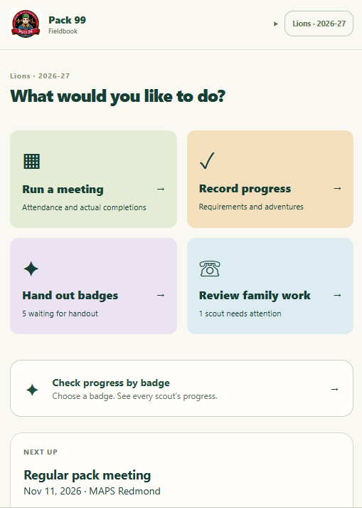
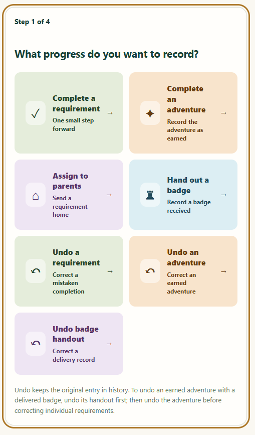
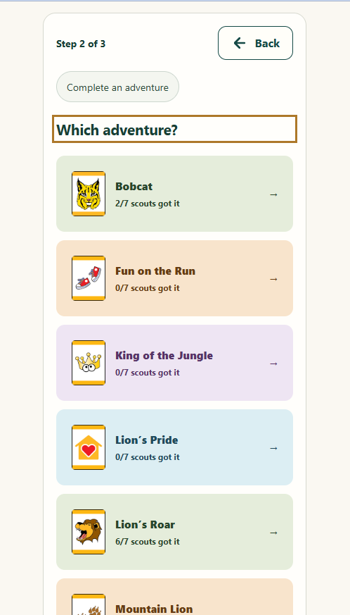
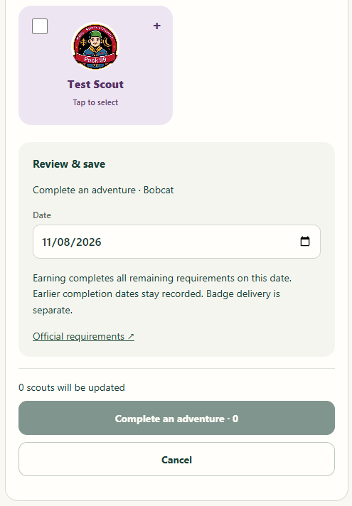
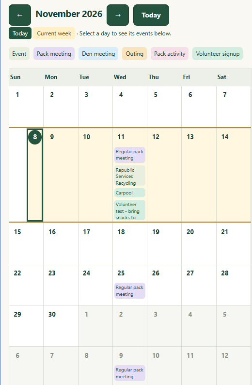
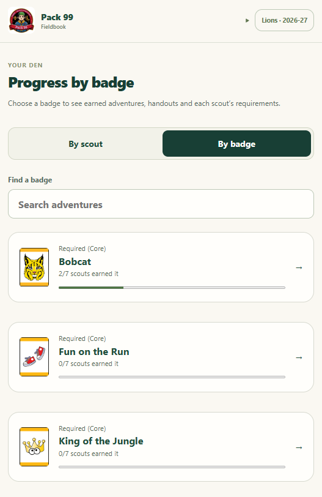
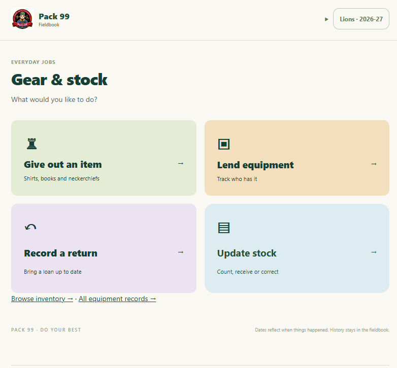
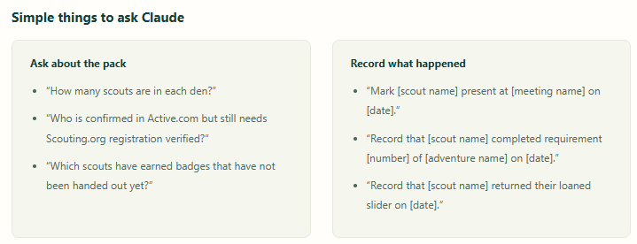

# PackPilot

A self-hosted Cub Scout fieldbook for leaders and families, with authenticated MCP access for AI assistants.

It tracks attendance, requirement progress, earned adventures, physical badge handouts, home assignments, messages, registration follow-ups and equipment. The application uses the same permissions for website and MCP access. It maintains its own records; it does not automatically synchronize with Scoutbook, but can export data to be imported by Scoutbook.

## Sample screens

Explore the leader dashboard, progress recording, calendar, badge tracking, inventory and AI assistant prompts. Screenshots show PackPilot configured for Pack 99.

<table>
  <tr>
    <th>Leader dashboard</th>
    <th>Record progress</th>
  </tr>
  <tr>
    <td></td>
    <td></td>
  </tr>
  <tr>
    <th>Choose an adventure</th>
    <th>Review and save</th>
  </tr>
  <tr>
    <td></td>
    <td></td>
  </tr>
  <tr>
    <th>Calendar</th>
    <th>Progress by badge</th>
  </tr>
  <tr>
    <td></td>
    <td></td>
  </tr>
</table>

**Gear and stock**



**AI assistant prompts**



## Status

Developer-preview source candidate. The application architecture is unchanged: **Supabase Cloud + Cloudflare Pages + Google OAuth + Brevo**, with private off-site backup storage. No Docker, alternate authentication provider or generic SMTP transport is introduced.

**Bundled roster/inventory/catalog examples are fictional. The catalog is not a set of official advancement requirements.** The application references badge artwork through official Scouting America image URLs; standalone badge image files and copied requirement text are not distributed. The sample screenshots include the supplied instance’s branding and displayed badge artwork. Supply reviewed program content separately.

## Start here

1. Read [the setup guide](documentation/SETUP.md) and [configuration reference](documentation/CONFIGURATION.md).
2. Review [third-party notices](THIRD_PARTY_NOTICES.md) and the [MIT license](LICENSE).
3. Run the checks below. Only validation workflows are active by default.
4. Before publishing or using real family data, complete [the publication checklist](PUBLISHING.md).

## Local checks

Requires Node 22+, npm, Python 3.12+ and the pinned Python requirements. Deno and the Supabase CLI are npm development dependencies.

```bash
npm ci
npm run check
python -m pip install -r scripts/requirements.txt -r scripts/release/requirements.txt
python -m unittest discover -s tests -p 'test_*.py'
```

The tests use synthetic records and local database services. The optional real Auth/REST integration test needs Docker; it must use isolated services. Do not put live credentials into tests.

## Local development

Copy .env.example to .env and auth-ui/.env.example to auth-ui/.env.local. Enter your own project's public URL/key and consent origin. Then run npm run dev:auth and npm run dev:mcp in separate terminals. Google sign-in still requires your Supabase/Google setup; there is no production authentication bypass.

## Repository layout

- auth-ui/: mobile leader and family interfaces and MCP consent page.
- supabase/: migrations, permission checks and Edge Functions.
- notifications/: gated Brevo delivery, scheduling and notification links.
- catalog/: synthetic catalog and importer format.
- scripts/: importers, policy-page generation and operational utilities.
- tests/: synthetic behavior, permission and recovery checks.

Internal pack99-prefixed database, RPC and environment identifiers are retained for compatibility; they are not live deployment configuration. Use only your own operator/provider values.
